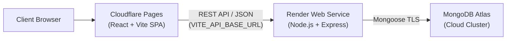

# Femme Vogue Fashion Platform — Deployment Guide

This comprehensive guide covers the step-by-step deployment of the **Femme Vogue Haute Couture Platform** using:
- **Database:** MongoDB Atlas
- **Backend:** Render (Node.js & Express)
- **Frontend:** Cloudflare Pages (React + Vite)

---

## Architecture Overview



---

## Step 1: MongoDB Atlas Database Setup

1. **Create an Account / Log In:**
   - Go to [MongoDB Atlas](https://www.mongodb.com/cloud/atlas) and sign in.
2. **Create a Free Cluster:**
   - Select **M0 Free Cluster** (e.g. AWS or GCP region closest to your users).
   - Click **Create Deployment**.
3. **Configure Database User:**
   - Under **Security > Database Access**, click **Add New Database User**.
   - Set **Authentication Method** to *Password*.
   - Username: e.g. `femme_admin`
   - Password: Generate a secure password and save it safely.
   - User Privileges: `Read and write to any database`.
4. **Configure Network IP Access:**
   - Under **Security > Network Access**, click **Add IP Address**.
   - Select **Allow Access From Anywhere (`0.0.0.0/0`)** so Render backend instances can reach the database.
   - Confirm and save.
5. **Get Connection String (URI):**
   - In **Deployment > Database**, click **Connect**.
   - Choose **Drivers > Node.js**.
   - Copy the connection string. It will look like:
     ```text
     mongodb+srv://femme_admin:<password>@cluster0.abcde.mongodb.net/femme_vogue?retryWrites=true&w=majority
     ```
   - Replace `<password>` with your actual database user password.

---

## Step 2: Backend Deployment on Render

1. **Push your code to GitHub / GitLab:**
   - Ensure the repository contains the `server/` directory and root files.
2. **Create New Web Service on Render:**
   - Log into [Render Dashboard](https://dashboard.render.com).
   - Click **New +** and select **Web Service**.
   - Connect your Git repository.
3. **Configure Web Service Settings:**
   - **Name:** `femme-vogue-backend`
   - **Root Directory:** `server`
   - **Environment:** `Node`
   - **Region:** Frankfurt (EU Central) or Oregon (US West)
   - **Branch:** `main`
   - **Build Command:**
     ```bash
     npm install
     ```
   - **Start Command:**
     ```bash
     node src/server.js
     ```
   - **Plan:** Free or Starter.
4. **Set Environment Variables on Render:**
   In the **Environment Variables** tab, add:
   | Key | Value |
   |---|---|
   | `NODE_ENV` | `production` |
   | `PORT` | `10000` (or leave default assigned by Render) |
   | `MONGODB_URI` | `mongodb+srv://femme_admin:<password>@cluster0.abcde.mongodb.net/femme_vogue?retryWrites=true&w=majority` |
5. **Deploy & Verify:**
   - Click **Create Web Service**.
   - Once deployed, note your public Render URL:
     `https://femme-vogue-backend.onrender.com`
   - Verify health check in your browser:
     `https://femme-vogue-backend.onrender.com/api/health`
6. **Seed Initial High-Fashion Catalog:**
   - Send a `POST` request to populate all products, trends, beauty protocols, and member data:
     ```bash
     curl -X POST https://femme-vogue-backend.onrender.com/api/seed
     ```

---

## Step 3: Frontend Deployment on Cloudflare Pages

Cloudflare Pages provides global edge distribution with blazing fast delivery.

### Option A: Git Integration (Recommended for CI/CD)

1. Log into the [Cloudflare Dashboard](https://dash.cloudflare.com/) and go to **Workers & Pages**.
2. Click **Create Application > Pages > Connect to Git**.
3. Select your repository.
4. Set Build Settings:
   - **Framework preset:** `Vite`
   - **Build command:** `cd client && npm install && npm run build` (or set Root directory to `client` and use `npm run build`)
   - **Build output directory:** `client/dist` (or `dist` if root directory is set to `client`)
   - **Root directory:** `client`
5. **Configure Environment Variables:**
   Under **Environment Variables**, add:
   | Variable | Value |
   |---|---|
   | `VITE_API_BASE_URL` | `https://femme-vogue-backend.onrender.com/api` |
6. Click **Save and Deploy**.
7. Cloudflare Pages will provide your live URL, e.g.:
   `https://femme-vogue.pages.dev`

### Option B: Direct Upload via Cloudflare Wrangler CLI

1. In your local terminal:
   ```bash
   cd client
   npm run build
   ```
2. Deploy the `dist/` directory directly to Cloudflare Pages:
   ```bash
   npx wrangler pages deploy dist --project-name=femme-vogue
   ```

### Single Page Application (SPA) Routing on Cloudflare Pages

To ensure that direct navigation to subpaths (e.g. `/trends`, `/shop`, `/salon`) functions properly on page refresh:
- Vite automatically outputs `dist/index.html`. Cloudflare Pages serves `index.html` for 404s on SPA presets.
- If using custom domain or manual rules, add a `_redirects` file in `client/public/`:
  ```text
  /*    /index.html   200
  ```

---

## Step 4: Connecting Frontend and Backend

1. **Verify CORS in Backend:**
   The backend in `server/src/server.js` already includes permissive CORS allowing Cloudflare Pages:
   ```javascript
   app.use(cors({
     origin: '*',
     methods: ['GET', 'POST', 'PUT', 'DELETE', 'OPTIONS'],
     allowedHeaders: ['Content-Type', 'Authorization']
   }));
   ```
2. **Verify Frontend Environment URL:**
   In Cloudflare Pages, `VITE_API_BASE_URL` points directly to your Render backend:
   ```text
   VITE_API_BASE_URL=https://femme-vogue-backend.onrender.com/api
   ```
3. **End-to-End Test Checklist:**
   - [x] Home page loads trending lookbook carousel.
   - [x] Boutique page loads 6 atelier pieces with color variants and filters.
   - [x] Complete Capsule Bundle "The Parisian Sunday Uniform" adds to cart with discount.
   - [x] Adding to cart opens bag drawer, calculates subtotals, and accepts coupon `NOCTURNE15`.
   - [x] Checkout modal completes order, returns order number `FV-XXXXX`, and updates live tracking.
   - [x] Style Quiz answers 5 questions and computes personalized Archetype Dossier.
   - [x] Trend Radar plays stylist audio note with live soundwave simulation.
   - [x] Member Salon displays VIP profile, active delivery status, saved wishlist, and calendar invitations.

---

## Local Development Quickstart

To run both backend and frontend locally:

1. **Install dependencies:**
   ```bash
   cd server && npm install
   cd ../client && npm install
   ```

2. **Start Backend (Port 5000):**
   ```bash
   cd server
   npm run dev
   ```

3. **Start Frontend (Port 5173):**
   ```bash
   cd client
   npm run dev
   ```

4. **Open Browser:**
   Navigate to [http://localhost:5173](http://localhost:5173).
   Vite automatically proxies API requests to `http://localhost:5000/api`.
